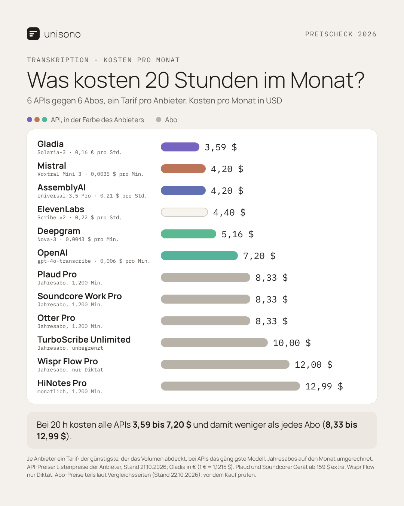
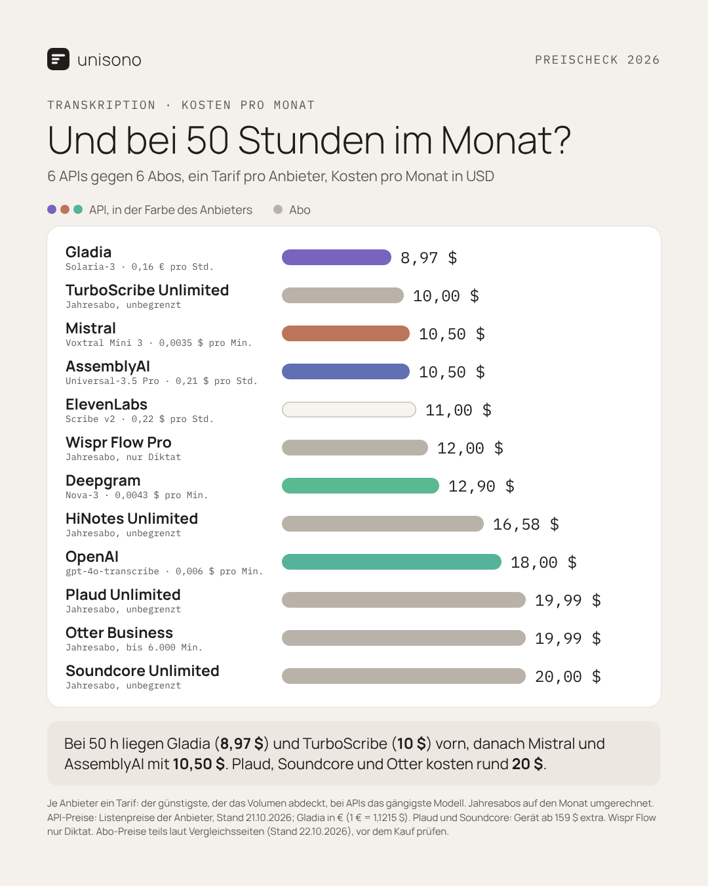
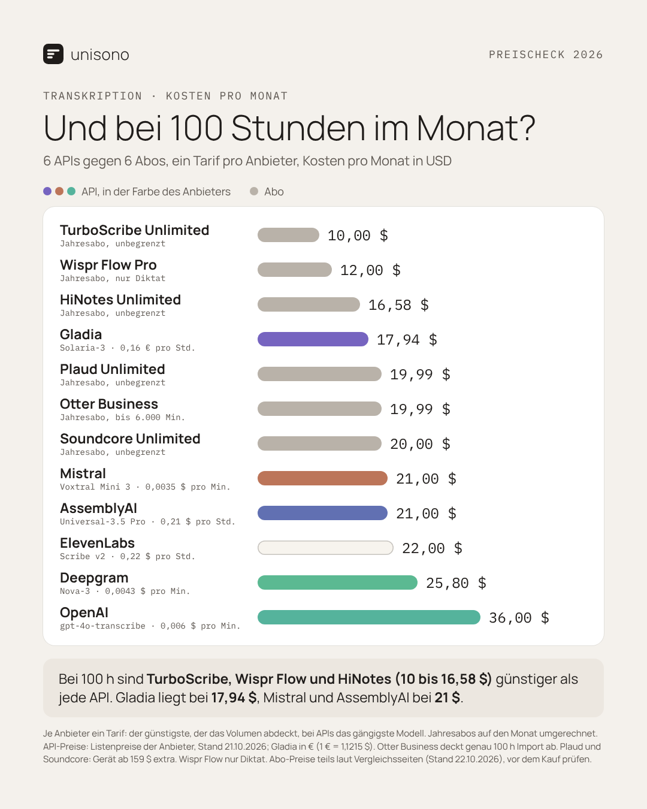

<p align="center">
  <picture>
    <source media="(prefers-color-scheme: dark)" srcset="docs/design/icon/export/svg/diktat-icon-white.svg">
    
  </picture>
</p>

<h1 align="center">diktat</h1>

<p align="center">
  Diktieren in jeder Android-App: sprechen, die KI räumt den Text auf, er steht im Feld.<br>
  Mit eigenen API-Keys, ohne Konto, ohne Server dazwischen, ohne Telemetrie.
</p>

---

## Was diktat kann

- **Schwebender Button „Wolke“** über jeder App, mit jeder Tastatur. Antippen zum
  Starten und Stoppen oder gedrückt halten zum Aufnehmen, wählbar unter Einstellungen › Aufnahme.
- **Langdiktat**: Lange Diktate werden schon während des Sprechens in Abschnitten transkribiert, geschnitten an
  Sprechpausen. Am Ende ist der Text fast sofort da.
- **Spracheingabe für andere Tastaturen**: Tastaturen, deren Mikrofon-Taste auf die Spracheingabe umschaltet (zum
  Beispiel SwiftKey), und Apps, die Androids Spracherkennung nutzen, diktieren über diktat.
- **Stile**: Wie die KI aufräumt. Mitgeliefert sind Aufräumen, Wörtlich, E-Mail, Chat und Aktenvermerk. Eigene Stile
  lassen sich im Tab „Stile“ anlegen, bearbeiten und löschen. Der aktive Stil läuft nach jedem Diktat.
- **Wörterbuch**: Eigene Wörter (Namen, Fachbegriffe), die das Sprachmodell richtig schreiben soll, und Ersetzungen,
  die nach dem Diktat automatisch getauscht werden.
- **Datei transkribieren**: Audio- und Videodateien teilen oder mit diktat öffnen.
- **Live mitschreiben (Echtzeit)**: Der Text erscheint schon beim Sprechen, mit ElevenLabs, Deepgram, Mistral, Gladia,
  AssemblyAI, Soniox, OpenAI, Gemini, xAI oder einem Offline-Modell auf dem Gerät.
- **Preise sichtbar**: Die Modellauswahl zeigt neben jedem Modell den Listenpreis in € pro Stunde Audio, auch bei den
  Echtzeit-Modellen ([`docs/PREISE.md`](docs/PREISE.md)).
- **Verlauf und Statistik**: Letzte Diktate zum Kopieren, Wörter gesamt, diesen Monat, Tage in Folge.
- **Offline-Erkennung** auf dem Gerät, ganz ohne Netz und Anbieter.
- **Sichern und Wiederherstellen** aller Einstellungen, auf Wunsch mit API-Keys.
- **Einfügen, das nicht verloren geht**: Nimmt eine App den Text nicht an, liegt er in der Zwischenablage und
  wird beim nächsten Tippen ins Feld oder auf die Wolke eingefügt.

### Anbieter

Transkription und Aufräumen sind getrennt wählbar, jeweils mit eigenem Schlüssel:

OpenAI · ElevenLabs Scribe · Anthropic (Claude) · Groq · Google Gemini · Mistral · Deepgram · AssemblyAI (mit Sync-Modell) · Gladia · Soniox ·
Azure Speech · OpenRouter · DeepInfra · Together AI · xAI (Grok) · DeepSeek · Cerebras · SiliconFlow · Scaleway · OVHcloud ·
Ollama · eigener OpenAI-kompatibler Server · On-device (offline)

AssemblyAI gibt es als einen Eintrag: die normalen Modelle laufen asynchron (Hochladen, Warten), das Modell
`universal-3-5-pro-sync` beantwortet kurze Aufnahmen in einer einzigen Anfrage. Ein Key, Region Global oder EU.

## Oberfläche

Warmer, ruhiger Look („Entwurf 3“): Papier und Tinte, Manrope und IBM Plex Mono, vier Tabs, hell und dunkel. Die
Bilder sind die Design-Referenzen aus [`docs/design/entwurf-3/`](docs/design/entwurf-3/), nach denen die App gebaut ist, keine
Bildschirmfotos der fertigen App; Namen, Anbieter und Texte darin sind Beispiele.

<p align="center">
  
  
  
  
</p>

Die **Wolke** ist eine Glaskugel mit farbigem Rauch, die sich beim Sprechen leicht hebt. Es gibt fünf Paletten:
Lagune, Periwinkle, Salbei, Abendrot und Tinte.

<p align="center">
  
</p>

## Preisvergleich: API oder Abo?

Was kosten 20, 50 oder 100 Stunden Transkription im Monat, wenn du direkt über die API bezahlst (diktat mit eigenem Key) oder ein Abo nimmst? Die API-Preise sind die Listenpreise aus [`docs/PREISE.md`](docs/PREISE.md), Stand 21.10.2026. Die Abo-Preise stammen teils aus Vergleichsseiten und sind vor einem Kauf zu prüfen. Alles in USD pro Monat, ein Tarif pro Anbieter.

<table>
  <tr>
    <td></td>
    <td></td>
    <td></td>
  </tr>
</table>

- **Bis etwa 20 Stunden** ist die API immer billiger als ein Abo.
- **Bei 50 Stunden** liegen Gladia (8,97 $) und TurboScribe (10 $) vorn; Mistral und AssemblyAI folgen mit 10,50 $.
- **Ab 100 Stunden** sind die Flatrate-Abos von TurboScribe, Wispr Flow und HiNotes (10 bis 16,58 $) günstiger als jede API; Gladia liegt bei 17,94 $.

## Installieren

**[⬇ diktat-APK herunterladen](https://github.com/Luxx1993/unisono-diktat/raw/apk/Dictate-Diktat-arm64.apk)**
(Android, 64-Bit-Handys wie das Galaxy S24, etwa 75 MB)

1. Den Link auf dem Handy öffnen, die Datei herunterladen und antippen.
2. Beim ersten Mal erlaubt Android die Installation aus dieser Quelle (Einstellungen › „Diese Quelle zulassen“),
   danach „Installieren“. Eine ältere diktat-Version wird dabei aktualisiert, Einstellungen bleiben erhalten.
3. App öffnen und weiter bei „Einrichten“.

Für Google Play gibt es eine eigene Signatur und ein App-Bundle (`scripts/build-play-bundle.sh`); die Schritte stehen in
[`docs/play-store/ANLEITUNG.md`](docs/play-store/ANLEITUNG.md). Die Debug-APK und die Play-Version lassen sich nicht
übereinander installieren.

Die Datei liegt auf dem Zweig [`apk`](https://github.com/Luxx1993/unisono-diktat/tree/apk), dort stehen auch Commit
und Prüfsumme der aktuellen Version. Selbst bauen: siehe [Bauen](#bauen).

## Einrichten

1. diktat öffnen.
2. Anbieter wählen und API-Key eintragen, für die Transkription und für das Aufräumen, gern bei verschiedenen
   Anbietern. Oder ein Offline-Modell laden.
3. **Wolke**: Unter Einstellungen › Schwebender Button einschalten und in Android die Bedienungshilfe „diktat
   Floating-Button“ erlauben. Die Wolke erscheint, sobald ein Textfeld aktiv ist.
4. **Optional, Mikrofon-Taste deiner Tastatur**: Unter Einstellungen › Spracheingabe diktat als Eingabemethode
   einschalten. Deine Tastatur bleibt, wie sie ist.

## Bauen

```bash
./gradlew :app:assembleDebug
```

Die APK liegt unter `app/build/outputs/apk/debug/`. Debug-Builds haben das Paket `app.diktat` und
sind mit einem Debug-Schlüssel signiert.

Die fertige APK für den festen Download-Link stellt `scripts/publish-apk.sh` auf den Zweig `apk` (baut, kopiert, pusht).

## Dokumentation

- [`docs/FUNKTIONEN.md`](docs/FUNKTIONEN.md): Was die App können soll und heute kann
- [`docs/PREISE.md`](docs/PREISE.md): Preise der Spracherkennung je Modell in € pro Stunde
- [`docs/play-store/`](docs/play-store/): Veröffentlichung bei Google Play (Anleitung, Datenschutzerklärung, Store-Texte)
- [`docs/design/diktat-design.md`](docs/design/diktat-design.md): Design-Entscheidungen (Oberfläche, Wolke, Icon)
- [`CLAUDE.md`](CLAUDE.md): Arbeitsstand und nächste Aufgaben

## Herkunft und Lizenz

diktat ist ein Fork von [Dictate Keyboard](https://github.com/DevEmperor/DictateKeyboard) von DevEmperor, das
seinerseits auf [FlorisBoard](https://github.com/florisboard/florisboard) von Patrick Goldinger und Mitwirkenden
aufbaut. Aus Dictate Keyboard stammen die Diktier-Logik, die Anbieter und der schwebende Button. Neu in diktat sind
die Oberfläche, die Wolke, das Icon und die Stile. Die Tastatur und ihr Zubehör sind entfernt.

Lizenz: [Apache 2.0](LICENSE), siehe auch [NOTICE](NOTICE). Lizenzen der verwendeten Bibliotheken und Modelle stehen
in der App unter Über.
